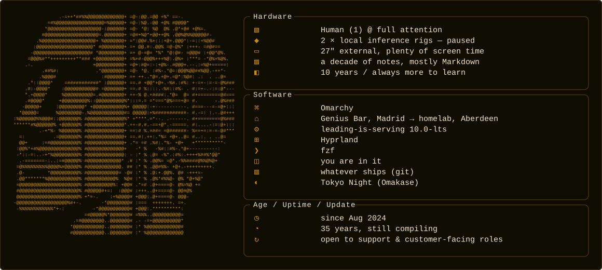

Hi! I'm Javier, ex-Apple Genius. Ten years fixing people's tech; now I help people and their AI agents get unstuck. Hermes runs my day and I build plugins for it. Vibe coder, proud of it: I spec and test, AI agents write the code. Open source must win.

- **[Machines Do It Better](https://github.com/ponzgpt/machines-do-it-better)** · [live](https://mdib.technoir.cloud): my main project, in progress. AI agents set up for you on open models and harnesses like Hermes, so you own them.
- **[Psychopomp](https://github.com/ponzgpt/psychopomp)**: a Hermes plugin. Every week it helps you write a page of your life; if you ever go silent for good, it carries your words to the people you love.
- **[Sabbath](https://github.com/ponzgpt/sabbath)**: a Hermes plugin. Your agent never rests. Now it rests with you.
- **[Neuronara](https://github.com/ponzgpt/neuronara)** · [live](https://neuronara.technoir.cloud): cited answers over clinical neurophysiology standards, built for my partner and improved in a feedback loop with her.
- **[ASI Rush](https://github.com/ponzgpt/asi-rush)** · [play](https://asi-rush.technoir.cloud): a clicker about the real race to AI, from a garage to superintelligence.
- **[Post-Labor Wiki](https://github.com/ponzgpt/post-labor-wiki)** · [live](https://post-labor-wiki.technoir.cloud): a visual, source-first wiki on post-labor economics.

More about me, and everything else I've built: **[javierponz.technoir.cloud](https://javierponz.technoir.cloud)** · [LinkedIn](https://www.linkedin.com/in/javierponz) · [X @sudotechnoir](https://x.com/sudotechnoir) · Discord: sudotechnoir
